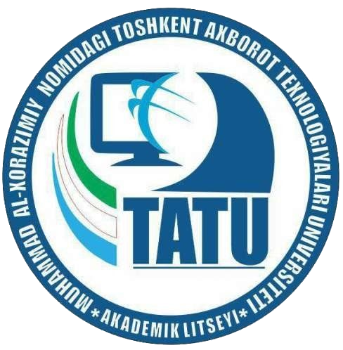

# Muhammad al-Xorazmiy nomidagi TATU Akademik Litseyi — Rasmiy Veb-Sayti

<p align="center">
  
</p>

<p align="center">
  <b>Muhammad al-Xorazmiy nomidagi Toshkent axborot texnologiyalari universiteti (TATU) huzuridagi akademik litseyining rasmiy veb-portali va boshqaruv tizimi (CMS).</b>
</p>

<p align="center">
  
  
  
  
  
</p>

---

## 📌 Loyiha Haqida (About the Project)

Ushbu veb-portal Muhammad al-Xorazmiy nomidagi TATU Akademik Litseyining o'quv jarayoni, qabul qoidalari, kafedralar, ilmiy yutuqlar, galereya va yangiliklarini keng jamoatchilikka tezkor, qulay va zamonaviy ko'rinishda yetkazish uchun yaratilgan.

Loyiha to'liq **Next.js 16 (App Router)** arxitekturasida qurilgan bo'lib, yuqori darajadagi SEO (Search Engine Optimization), mobil moslashuvchanlik va ma'lumotlarni qulay boshqarish uchun shaxsiy **Admin CMS paneli** bilan ta'minlangan.

### 🏛️ Litseyning Rasmiy Ko'rsatkichlari (Official Stats):
* 🎓 **474** — O'quvchilar soni
* 📖 **8 ta** — Fan va ixtisoslashtirilgan to'garaklar
* ⏱️ **2 yil** — Chuqurlashtirilgan akademik ta'lim muddati
* 📈 **95%+** — OTMga kirish ko'rsatkichi

---

## ⚡ Asosiy Texnologiyalar (Tech Stack)

* **Frontend Framework:** Next.js 16.2.3 (App Router, Turbopack, SSR & SSG)
* **UI Library:** React 19 & TypeScript
* **Styling:** Tailwind CSS 4 & Custom Glassmorphism Theme
* **Icons & Animations:** Lucide React & Framer Motion
* **Database & Storage:** Supabase (PostgreSQL, Storage Buckets, Row-Level Security, Auth)
* **Instant Notifications:** Telegram Bot API (aloqa formasidan kelgan xabarlarni admin guruhiga yetkazish)
* **Sanitization:** DOMPurify (XSS hujumlariga qarshi himoya)

---

## 🌟 Imkoniyatlar va Modullar (Features)

### 1. Ommaviy Portal (Public Portal)
* **Bosh sahifa (`/`):** Dinamik hero karuseli, statistik hisoblagichlar (Animated Counters), yo'nalishlar (Texnika va Iqtisodiyot), rahbariyat va so'nggi yangiliklar.
* **Biz haqimizda (`/about`):** Litsey tarixi, missiyasi, rahbariyat profillari, interaktiv FAQ bloki.
* **Qabul 2026 (`/admission`):** Bosqichma-bosqich yo'riqnoma, qabul talablari va **interaktiv Accordion/Dropdown qoidalar bo'limi**.
* **Kafedralar (`/departments`):** Barcha kafedralar, kafedra mudirlari va professor-o'qituvchilar tarkibi.
* **Yangiliklar (`/news` & `/news/[id]`):** Teglar bo'yicha filtrlash, jonli qidiruv, fotogalereya va ijtimoiy tarmoqlar uchun boyitilgan OpenGraph kartalari.
* **Yutuqlar (`/science`):** Respublika va xalqaro olimpiada sovrindorlari, Cisco, IELTS sertifikatlari statistikasi.
* **Fotogalereya (`/gallery`):** Kategoriya filtrlari (Tadbirlar, Dars jarayoni, Bino, Sport), klaviatura navigatsiyasiga ega (Esc, ←, →) to'liq ekranli fotoviewer.
* **Aloqa (`/contact`):** Interaktiv xarita, aloqa ma'lumotlari va to'g'ridan-to'g'ri Telegram botga yuboruvchi xavfsiz forma.

### 2. Skelet Yuklanish Tizimi (Skeleton Shimmer Loaders)
* Serverdan ma'lumotlar yuklanguncha sahifa sakramaydi (Cumulative Layout Shift — CLS = 0).
* `NewsCardSkeleton`, `GalleryCardSkeleton`, `DepartmentCardSkeleton` va `LeadershipCardSkeleton` orqali silliq va zamonaviy yuklanish effekti.

### 3. Keng Qamrovli SEO va Semantika (Enterprise SEO)
* **JSON-LD Schema Markup:**
  * `EducationalOrganization` (TATUga qarashlilik, geo-koordinatalar, rasmiy kanallar, ish vaqti).
  * `BreadcrumbList` — qidiruv botlari sahifalar ierarxiyasini to'g'ri ko'rsatishi uchun barcha ommaviy sahifalarda mavjud.
  * `FAQPage` — Google qidiruv natijalarida to'g'ridan-to'g'ri savol-javob ochiluvchi bloklarini ko'rsatish.
  * `NewsArticle` — har bir yangilik uchun muallif, rasm va e'lon qilingan vaqt ko'rsatkichi.
* Dinamik `sitemap.xml` va xavfsiz sozlangan `robots.txt`.

### 4. Boshqaruv Paneli (Admin CMS — `/altuit-dashboard`)
* **Avtorizatsiya va Himoya:** Supabase Auth + Next.js Middleware himoyasi.
* **Hero Slider Boshqaruvi:** Yangi banner yuklash, faol/nofaol qilish, tartib raqamini belgilash.
* **Yangiliklar Muharriri:** Matnlarni ko'p tilli kiritish, ko'p rasmli galereya yuklash, Desktop va Mobile ko'rinishida oldindan ko'rish (Preview).
* **Statistika va Qabul:** Bosh sahifadagi ko'rsatkichlar va qabul qoidalarini bazadan turib yangilash.
* **O'qituvchilar va Kafedralar:** O'qituvchi ma'lumotlari, fotosuratlari va kafedralarni boshqarish.

---

## 📁 Loyiha Tuzilmasi (Project Structure)

```
altuit/
├── public/                     # Statik rasmlar, logotiplar va ikonlar
├── src/
│   ├── app/
│   │   ├── layout.tsx          # Asosiy layout, Meta teglar, Geo-teglar, JSON-LD
│   │   ├── page.tsx            # Bosh sahifa (Metadata)
│   │   ├── HomeClient.tsx      # Bosh sahifa mijoz komponenti
│   │   ├── robots.ts           # Avtomatik /robots.txt
│   │   ├── sitemap.ts          # Dinamik /sitemap.xml
│   │   ├── about/              # Biz haqimizda sahifasi
│   │   ├── admission/          # Qabul sahifasi (Accordion qoidalar bilan)
│   │   ├── departments/        # Kafedralar sahifasi
│   │   ├── gallery/            # Fotogalereya sahifasi
│   │   ├── science/            # Ilmiy yutuqlar sahifasi
│   │   ├── contact/            # Aloqa sahifasi
│   │   ├── news/               # Yangiliklar arxivi
│   │   │   └── [id]/           # Yangilikning batafsil sahifasi
│   │   ├── login/              # Admin login sahifasi
│   │   ├── api/
│   │   │   └── contact/        # Telegram Bot API integratsiyasi
│   │   └── altuit-dashboard/   # Himoyalangan Admin CMS paneli
│   │       ├── hero/           # Hero slaydlar boshqaruvi
│   │       ├── news/           # Yangiliklar CRUD
│   │       ├── stats/          # Statistika boshqaruvi
│   │       ├── teachers/       # O'qituvchilar boshqaruvi
│   │       ├── departments/    # Kafedralar boshqaruvi
│   │       ├── gallery/        # Galereya boshqaruvi
│   │       ├── admission/      # Qabul qoidalari boshqaruvi
│   │       └── _components/    # Reusable Admin UI komponentlari
│   ├── components/
│   │   ├── Navbar.tsx          # Asosiy navigatsiya paneli
│   │   ├── Footer.tsx          # Sayt podvali va ijtimoiy havolalar
│   │   └── Skeleton.tsx        # Zamonaviy Shimmer skelet komponentlari
│   └── lib/
│       ├── config.ts           # Sayt global konfiguratsiyasi (URL, nom)
│       ├── db.ts               # Supabase ma'lumotlar bazasi amallari (CRUD)
│       ├── supabase.ts         # Supabase client konfiguratsiyasi
│       ├── i18n.ts             # Ko'p tillilik lug'ati (UZ, RU, EN)
│       └── useAsyncData.ts     # Ma'lumotlarni yuklash uchun custom hook
├── supabase-schema.sql         # Supabase PostgreSQL jadvallari va strukturasi
├── supabase-security-hardening.sql # RLS xavfsizlik qoidalari
├── next.config.ts              # Next.js optimallashtirish sozlamalari
└── package.json
```

---

## 🚀 Ishga Tushirish (Getting Started)

### Talablar (Prerequisites)
* Node.js 18.18+ yoki 20+
* npm, pnpm yoki yarn
* Supabase hisobi

### O'rnatish (Installation)

1. **Repozitoriyni klonlash:**
   ```bash
   git clone https://github.com/MusayevDoniyor/AlTUIT_NEW.git
   cd AlTUIT_NEW
   ```

2. **Kutubxonalarni o'rnatish:**
   ```bash
   npm install
   ```

3. **Muhit o'zgaruvchilarini sozlash (`.env`):**
   Loyiha ildizida `.env` yoki `.env.local` faylini yarating va quyidagilarni kiriting:
   ```env
   NEXT_PUBLIC_SITE_URL=https://tatual.uz
   NEXT_PUBLIC_SUPABASE_URL=your-supabase-url
   NEXT_PUBLIC_SUPABASE_ANON_KEY=your-supabase-anon-key

   # Telegram Bot bildirishnomalari uchun (Aloqa formasi)
   TELEGRAM_BOT_TOKEN=your-telegram-bot-token
   TELEGRAM_CHAT_ID=your-telegram-chat-id
   ```

4. **Ma'lumotlar Bazasini Sozlash:**
   `supabase-schema.sql` faylidagi SQL kodlarini Supabase konsolidagi **SQL Editor** bo'limida ishga tushiring.

5. **Dasturni ishga tushirish (Development Mode):**
   ```bash
   npm run dev
   ```
   Brauzerda [http://localhost:3000](http://localhost:3000) manzilini oching.

---

## 🛠️ Foydali Skriptlar (Available Scripts)

| Buyruq | Vazifasi |
| :--- | :--- |
| `npm run dev` | Mahalliy serverni Turbopack bilan tezkor ishga tushiradi |
| `npm run build` | Ishlab chiqarish (Production) uchun loyihani tekshirib to'liq yig'adi |
| `npm run start` | Yig'ilgan loyihani production rejimida ishga tushiradi |
| `npm run lint` | ESLint orqali kod tozaligi va xatolarini tekshiradi |

---

## 🔒 Xavfsizlik (Security & Best Practices)

* **Next.js Middleware:** `/altuit-dashboard` manzili avtorizatsiyadan o'tmagan barcha foydalanuvchilar uchun yopiq va to'g'ridan-to'g'ri login sahifasiga yo'naltiradi.
* **Supabase RLS (Row-Level Security):** Ma'lumotlar bazasiga to'g'ridan-to'g'ri yozish/o'zgartirish faqat tasdiqlangan admin foydalanuvchilarga ruxsat berilgan.
* **XSS himoyasi:** Tashqi HTML kodlar faqat `DOMPurify` filtri orqali o'tkazilib, xavfsiz holda render qilinadi.

---

## 📄 Litsenziya va Mualliflik

Ushbu loyiha **Muhammad al-Xorazmiy nomidagi TATU Akademik Litseyi** uchun maxsus ishlab chiqilgan.
Saytning barcha huquqlari himoyalangan.
